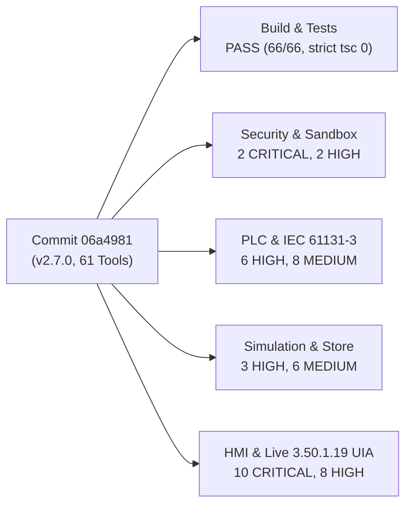

# Haiwell Cloud SCADA Develop MCP — Full Verification & Forensic Audit Report

> [!IMPORTANT]
> **Audit Target:** `haiwell-cloud-scada-develop-mcp` (`v2.7.0`) at latest `origin/main` commit `06a4981d6e574a6d86561b8902df2c5ed1c76329` + generated deliverables in `test-mcp-bundle`
> **Audit Date:** 2026-11-24
> **Host Environment:** Windows (`win32`), Node.js `v24.13.0`, TypeScript `7.0.2`, Python `3.13` (`C:\Users\user\python313\python.exe`), live `Haiwell Cloud Scada[3.50.1.19]` at `C:\Program Files (x86)\Haiwell\HaiwellScada3\Scada.Develop.exe`

---

## 1. Executive Summary

`git fetch --all --prune && git pull --ff-only` confirmed `main` is **already up to date** with `origin/main` at commit `06a4981` (`18 files changed, +2816 / -744 lines`; working tree clean; `stash@{0}: On main: pre-pull-backup` intact).

All **automated build, typecheck, unit/integration, and wire-protocol checks pass** (`tsc --noEmit` exit `0`, `tsc --noEmit --strict` exit `0`, **66/66** tests passing including **1,388** adversarial assertions, all 10 HTTP endpoints, all 5 MCP Streamable HTTP profiles, live `stdio` JSON-RPC across 61 tools / 15 resources / 2 templates / 6 prompts, and `test-mcp-bundle` PowerShell AST + Python `py_compile` + `--dry-run`).

However, deep static analysis, live reproduction scripts, and cross-checking against the real installed **Haiwell Cloud Scada 3.50.1.19** binaries (`en.lng`, `zh-cn.lng`, `Modbus.Master.TCP.dev`, `haiwell_uia_dump.json`) uncovered **12 CRITICAL** and **19 HIGH** defects that are **not caught by the existing test suite**:

> [!CAUTION]
> **Two Critical Security Vulnerabilities Were Live-Reproduced:**
> 1. **Complete Express Bearer Auth & Rate-Limit Bypass (`server.ts`):** Sending requests to `/mcp/`, `/MCP`, `/api/rpc/`, `/API/RPC`, or `/API/PROJECTS/:id/export` returns **`HTTP 200`** with no `Authorization` header even when `HAIWELL_MCP_AUTH_TOKEN` is enforced (`POST /mcp` returns `401`).
> 2. **Node.js `node:vm` Sandbox Escape (`simulationEngine.ts` + `scriptAnalyzer.ts`):** Compound string assignment (`var k = "con"; k += "structor"`) bypasses `validateHaiwellScript` (`valid: true`), and accessing `Tag.Read[k][k]` reaches the **host-realm `Function` constructor** (not restricted by `codeGeneration: { strings: false }`), executing arbitrary JS inside the host Node.js process (live-verified returning `42` with `vmErrors: []`).

Additionally, **live Windows UIA automation** (`calibrate_haiwell_uia.py`, `apply_to_test_mcp.py`, `haiwell_hmi_desktop_bridge_export`, `new_project_wizard.ps1`) has **10 Critical** failures when run against a real Haiwell 3.50.1.19 window, and several **High** engineering bugs remain in the IEC 61131-3 ST transpiler (`LN()`, `WORD NOT`, `PID` `NaN`, `**`), CSV register classification (`IR:10`, `IW0`, `MW10`, `T0`, `310000`), `BASE_1` forwarding, OPC UA `HistoryRead` writes, `normalizeAgentArgs` (`lwtPayload`), and `EventTriggerRule` `RUN_ONCE`.

### Overall Health Scorecard



| Domain | Build / Tests | Critical | High | Medium | Low / Info | Production Readiness |
| :--- | :---: | :---: | :---: | :---: | :---: | :--- |
| **HTTP Server, Auth, Rate Limit & MCP Wire** | Pass | **1** | 0 | 3 | 3 | **Blocked** (trailing-slash/case auth bypass) |
| **Project Store, Protocols, CSV & Tool Registry** | Pass | 0 | **5** | 6 | 8 | **Needs Fixes** (`normalizeLoadedProject`, `BASE_1`, CSV, `HistoryRead`, `lwtPayload`) |
| **PLC Addressing & Haiwell Registers** | Pass | 0 | **1** | 4 | 1 | **Needs Fixes** (S7 `DBW`/`DBB` byte overlap, `BASE_1`, Delta DVP bounds) |
| **IEC 61131-3 ST / LD / FBD Validator & Transpiler** | Pass | 0 | **4** | 5 | 0 | **Needs Fixes** (`LN`, `WORD NOT`, `PID` `NaN`, `**`, `XOR`) |
| **Script Analyzer & Headless Simulation Engine** | Pass | **1** | **2** | 8 | 1 | **Blocked** (`vm` host-realm escape, `RUN_ONCE`, standalone alarm delays) |
| **HMI Generator, Spatial P&ID & SVG** | Pass | 0 | **3** | 4 | 2 | **Needs Fixes** (RO write audit bypass, return pipe crossings, SVG XSS/labels) |
| **Live Windows UIA Bridges & PowerShell Wizard** | Dry-Run Pass | **10** | **4** | 3 | 2 | **Not Ready for Live GUI** (10 guaranteed UIA failures on 3.50.1.19) |
| **Packaging, Config & Documentation** | Pass | 0 | 0 | 3 | 3 | **Needs Cleanup** (`tsx` in `devDependencies`, 13 unused deps, stale docs) |
| **Totals** | **66/66 Pass** | **12** | **19** | **36** | **20** | **Remediate P0/P1 before production deployment** |

---

## 2. Git Sync & Automated Verification Results

### 2.1 Git Repository State
- **Repo Path:** [haiwell-cloud-scada-develop-mcp](file:///c:/Users/user/Downloads/haiwell%20mcp/haiwell-cloud-scada-develop-mcp)
- **Remote:** `https://github.com/seniorhwan/haiwell-cloud-scada-develop-mcp.git`
- **Branch:** `main` tracking `origin/main` (`Already up to date` on `git pull --ff-only`)
- **HEAD Commit:** `06a4981d6e574a6d86561b8902df2c5ed1c76329` (*"Harden all 7 SCADA/PLC/UIA domains and align CSV + UIA to Haiwell 3.50.1.19"*, 18 files changed, `+2816 / -744`)
- **Stash:** `stash@{0}: On main: pre-pull-backup` (preserved untouched)
- **Codebase Size:** 33 tracked source/test/config files (~21,600 LOC across `src/mcp/*.ts`, `server.ts`, tests, and configs; largest files: [toolRegistry.ts](file:///c:/Users/user/Downloads/haiwell%20mcp/haiwell-cloud-scada-develop-mcp/src/mcp/toolRegistry.ts) at 5,058 lines, [hmiSpatialEngine.ts](file:///c:/Users/user/Downloads/haiwell%20mcp/haiwell-cloud-scada-develop-mcp/src/mcp/hmiSpatialEngine.ts) at 2,457 lines, [iec61131.ts](file:///c:/Users/user/Downloads/haiwell%20mcp/haiwell-cloud-scada-develop-mcp/src/mcp/iec61131.ts) at 2,198 lines).

### 2.2 Live Verification Matrix

| Check | Command / Target | Result | Observed Evidence |
| :--- | :--- | :---: | :--- |
| **TypeScript Lint** | `npm run lint` (`tsc --noEmit`) | **PASS** | Exit `0`, 0 errors |
| **TypeScript Strict** | `tsc --noEmit --strict` | **PASS** | Exit `0`, 0 errors under TS `7.0.2` |
| **Full Test Suite** | `npm test` (`tsx --test src/mcp/*.test.ts`) | **PASS** | **66/66** passed (`10.99s`), `1,388` adversarial assertions verified |
| **Dependency Audit** | `npm audit --omit=dev` | **N/A (`ENOLOCK`)** | Repo ships [bun.lock](file:///c:/Users/user/Downloads/haiwell%20mcp/haiwell-cloud-scada-develop-mcp/bun.lock) only; no `package-lock.json` |
| **HTTP Discovery & Skills** | 10 `GET` endpoints (`/`, `/api/health`, `/api/manifest`, `/openapi.json`, `/llms.txt`, `/api/skills/*`) | **PASS** | All returned `200`, valid JSON/Markdown/text, zero HTML |
| **MCP Streamable HTTP** | `POST /mcp?profile={all,core,hmi,plc,iiot}` | **PASS** | Tool counts: `all=61`, `core=14`, `hmi=29`, `plc=20`, `iiot=32` |
| **Direct Batch RPC** | `POST /api/rpc` (single & JSON array batch) | **PASS** | `batchCount=2`, seeded `prj_chiller_plant_01` audit `total=0`, `deploymentReady=true` |
| **MCP `stdio` Transport** | Live spawn of [stdio.ts](file:///c:/Users/user/Downloads/haiwell%20mcp/haiwell-cloud-scada-develop-mcp/src/mcp/stdio.ts) | **PASS** | `61` tools, `15` resources, `2` templates, `6` prompts, live `tools/call` `ok` |
| **Catalog Parity** | `HAIWELL_TOOLS` vs `HAIWELL_CAPABILITY_MATRIX` | **PASS** | `61/61` tools mapped (`missingFromMatrix: []`) |
| **Host Haiwell Discovery** | `haiwell_desktop_inspect` | **PASS** | Found `C:\Program Files (x86)\Haiwell\HaiwellScada3\Scada.Develop.exe`, parsed `en.lng` (`en`, `portuguese`, `zh-cn`, `zh-tw`) |
| **Bundle PS1 AST** | `Parser::ParseFile` on [new_project_wizard.ps1](file:///c:/Users/user/Downloads/haiwell%20mcp/test-mcp-bundle/new_project_wizard.ps1) | **PASS** | `PS_AST_ERRORS=0` |
| **Bundle Python Compile** | `python -m py_compile` on calibrator + bridge | **PASS** | `PY_COMPILE_EXIT=0` |
| **Bundle Dry-Run** | `python .\apply_to_test_mcp.py --dry-run` | **PASS** | `DRY_RUN_EXIT=0` (`Valve1`, `New alarm table`, `Decimal digits`, `Float`, `Read only`) |

---

## 3. Audit of Prior `FAILURE_DOCUMENTATION.md` Remediations

Cross-checking the 6 failures documented in [FAILURE_DOCUMENTATION.md](file:///c:/Users/user/Downloads/haiwell%20mcp/haiwell-cloud-scada-develop-mcp/FAILURE_DOCUMENTATION.md) against commit `06a4981`:

| Prior Failure | Current Verdict | Residual Gaps Observed in `06a4981` |
| :--- | :---: | :--- |
| **#1 Missing `src/mcp/version.ts`** | **Solidly Fixed** | [version.ts](file:///c:/Users/user/Downloads/haiwell%20mcp/haiwell-cloud-scada-develop-mcp/src/mcp/version.ts) exports `'2.7.0'`, matching [package.json](file:///c:/Users/user/Downloads/haiwell%20mcp/haiwell-cloud-scada-develop-mcp/package.json). |
| **#2 `desktopAutomation.ts` discovery, `lang=0`, XML `.lng`, 2-step wizard** | **Partially Fixed** | Discovery and XML `.lng` parsing work on real 3.50.1.19; wizard script still has clipboard race / `IsReadOnly` crash, `Port` substring collision, unquoted spaces in `Start-Process`, and discarded OK check (`H4`–`H6`, `H9`). |
| **#3 `npm install` `ERESOLVE` & packaging** | **Partially Fixed** | `esbuild` bumped to `^0.28.0`, but `tsx` remains in `devDependencies` (breaks `npm install --omit=dev`), 13 unused frontend/AI Studio deps & 6 dead UI files remain, and `tsconfig.json` lacks explicit `"strict": true` / `"node"` types. |
| **#4 `runProjectSafetyAudit` HMI/hardware/dangling guards** | **Partially Fixed** | Enforces `AUD-HMI-LAYOUT` `HIGH`, `AUD-STARTUP-SCREEN`, A8 COM/Printer, IPC audio; still misses RO-tag HMI writes (`H2`), A8 `SERIAL_COM` RFID, `startupScreenId === undefined` when screens exist, and dangling `dataReportingServers` / `cameras` / `transparentTunnel` / `rfid` / `pous.boundTags` references. |
| **#5 SSRF guard in `probeTcpEndpoint`** | **Solidly Fixed** | IPv6 expansion, NAT64/6to4/mapped IPv4, BSD `inet_aton`, `%zone` strip, and `dns.promises.lookup(..., { all: true })` + direct IP connect are solid (minor gap: `0:0:0:0:0:ffff:7f00:1` loopback alias). |
| **#6 Multi-vendor PLC addressing & overlaps** | **Mostly Fixed** | Mixed Modbus coils, `%MX201.4`, and span bounds fixed; `06a4981` left `addressOffset: 'BASE_1'` dead-wired in `toolRegistry.ts` (`HIGH-02`) and missed S7 `DBW` `INT32` / `DBB` multi-byte overlaps (`HIGH-06`). |

---

## 4. Detailed Findings Register

### 4.1 CRITICAL — Security & Sandbox Isolation (2 Findings)

#### `CRIT-01` — Express Authentication & Rate-Limit Bypass via Trailing Slash or Case Variation
- **Location:** [server.ts](file:///c:/Users/user/Downloads/haiwell%20mcp/haiwell-cloud-scada-develop-mcp/server.ts#L85-L88), [server.ts](file:///c:/Users/user/Downloads/haiwell%20mcp/haiwell-cloud-scada-develop-mcp/server.ts#L176-L202) (`createApp`)
- **Root Cause:** Express 4 defaults to `strict routing = false` and `case sensitive routing = false`, while auth and rate-limiting middleware match `req.path` with exact case-sensitive checks (`req.path === '/mcp' || req.path === '/api/rpc' || req.path.startsWith('/api/projects/')`). Express still dispatches `/mcp/`, `/MCP`, `/api/rpc/`, `/API/RPC`, and `/API/PROJECTS/:id/export` to the protected route handlers with **both** Bearer auth and rate limiting bypassed.
- **Live Verification Proof** (`createApp(store, { authToken: 'secret-123' })`, no `Authorization` header):
  ```json
  { "/mcp": 401, "/mcp/": 200, "/MCP": 200, "/API/RPC": 200 }
  ```
- **Fix:** Normalize `const p = req.path.toLowerCase().replace(/\/+$/, '') || '/';` in auth, rate-limit, and JSON-RPC error middleware (or mount route-scoped middleware directly on `/mcp`, `/api/rpc`, `/api/projects`).

#### `CRIT-02` — Node.js `node:vm` Sandbox Escape via Host-Realm Function/Object Leakage + AST Bypass
- **Location:** [simulationEngine.ts](file:///c:/Users/user/Downloads/haiwell%20mcp/haiwell-cloud-scada-develop-mcp/src/mcp/simulationEngine.ts#L255-L373) (`createSandboxedContext`), [scriptAnalyzer.ts](file:///c:/Users/user/Downloads/haiwell%20mcp/haiwell-cloud-scada-develop-mcp/src/mcp/scriptAnalyzer.ts#L151-L173), [scriptAnalyzer.ts](file:///c:/Users/user/Downloads/haiwell%20mcp/haiwell-cloud-scada-develop-mcp/src/mcp/scriptAnalyzer.ts#L563-L582), [scriptAnalyzer.ts](file:///c:/Users/user/Downloads/haiwell%20mcp/haiwell-cloud-scada-develop-mcp/src/mcp/scriptAnalyzer.ts#L638-L646) (`evalStaticStringExpr`, `validateHaiwellScript`)
- **Root Cause:**
  1. `scriptAnalyzer.ts` only tracks `=` assignments and `+` concatenations; compound assignment (`k += "structor"`), `['con','structor'].join('')`, `String.fromCharCode(...)`, `.slice(...)`, indirect `this` aliasing (`var g = this; g.process`), and aliased `Object` (`var O = Object; O.getPrototypeOf(x)`) all pass `validateHaiwellScript` with `valid: true`.
  2. `createSandboxedContext` injects **host-realm functions and objects** (`Tag.Read`, `Variable.*`, `Common.database.query()` returning host `[]`, `Common.Ajax` passing host `{}`, and `fbState = {}` as `__fbState`/`__haiwellFbStore`). Their `.constructor.constructor` resolves to the **host realm's `Function` constructor**, which is **not** blocked by `vm.createContext(..., { codeGeneration: { strings: false } })`.
  3. Transpiled ST POUs run in the same `vmContext` without passing through `scriptAnalyzer.ts`.
- **Live Verification Proof:**
  - Script: `var k = "con"; k += "structor"; var F = Tag.Read[k][k]; var res = F("return 40 + 2")(); Variable.SetByFullName("Plant_DeltaT_C", res);`
  - Observed Result: `compoundAssignBypassValid: true`, `indirectThisBypassValid: true`, **`vmHostFunctionExecutedResult: 42`**, `vmErrors: []`.
- **Fix:** Treat `node:vm` as non-isolated for untrusted code; move untrusted script execution to a zero-capability QuickJS/WASM or AST interpreter (or isolated worker). As immediate defense-in-depth, disallow non-integer computed member access and `ThisExpression` aliasing in `scriptAnalyzer.ts`, use `Object.create(null)` for `fbState`, and wrap bridged functions inside the VM realm so no host prototype chain is exposed.

---

### 4.2 CRITICAL — Live Haiwell Cloud Scada 3.50.1.19 Windows UIA Automation Failures (10 Findings)

Cross-verified directly against live [haiwell_uia_dump.json](file:///c:/Users/user/Downloads/haiwell%20mcp/test-mcp-bundle/haiwell_uia_dump.json), `C:\Program Files (x86)\Haiwell\HaiwellScada3\Language\en.lng`, and `Device\PLC\Modbus.Master.TCP.dev`:

| ID | Location | Symbol | Defect & Live 3.50.1.19 Proof |
| :--- | :--- | :--- | :--- |
| **`UIA-01`** | [hmiSpatialEngine.ts](file:///c:/Users/user/Downloads/haiwell%20mcp/haiwell-cloud-scada-develop-mcp/src/mcp/hmiSpatialEngine.ts#L1745-L1748), [calibrate_haiwell_uia.py](file:///c:/Users/user/Downloads/haiwell%20mcp/test-mcp-bundle/calibrate_haiwell_uia.py#L44-L47) | `generateDesktopUiaCalibrator` | Parent MDI frames precede child controls in `win.descendants()` (live dump verified: `FrmWindow` at index **311**, `vectorControl1` at index **312**). Checking `auto_id in ("vectorControl1", "FrmWindow")` always latches `FrmWindow`, shifting canvas coordinates into MDI window chrome. Same shadowing occurs for `FrmVariableEditor` vs `fg`. |
| **`UIA-02`** | [hmiSpatialEngine.ts](file:///c:/Users/user/Downloads/haiwell%20mcp/haiwell-cloud-scada-develop-mcp/src/mcp/hmiSpatialEngine.ts#L2084-L2105), [apply_to_test_mcp.py](file:///c:/Users/user/Downloads/haiwell%20mcp/test-mcp-bundle/apply_to_test_mcp.py#L35-L56) | `navigate_tree` | Unanchored `title_re=f"(?i).*{re.escape(part)}.*"` without `found_index` throws `ElementAmbiguousError` on `"Display"` (4 matches in `treeView1`) and `"Task"` (3 matches). Blind `double_click_input()` collapses already-expanded branches (`Display`, `Task` are expanded by default). |
| **`UIA-03`** | [hmiSpatialEngine.ts](file:///c:/Users/user/Downloads/haiwell%20mcp/haiwell-cloud-scada-develop-mcp/src/mcp/hmiSpatialEngine.ts#L1881-L1919), [hmiSpatialEngine.ts](file:///c:/Users/user/Downloads/haiwell%20mcp/haiwell-cloud-scada-develop-mcp/src/mcp/hmiSpatialEngine.ts#L2165-L2183) | `run_devices` | Clicks non-existent `Button` `"New"` (`ElementNotFoundError`); waits for `"Property Setting"` instead of `en.lng` `"Add device"` (`FrmAddDevice`); uses `'Modbus TCP'`, `'CD AB'`, `'base 0'` instead of 3.50.1.19's `"Modbus Master(TCP/UDP)"`, `"CDAB"`, `"0"`. |
| **`UIA-04`** | [hmiSpatialEngine.ts](file:///c:/Users/user/Downloads/haiwell%20mcp/haiwell-cloud-scada-develop-mcp/src/mcp/hmiSpatialEngine.ts#L1809-L1857), [hmiSpatialEngine.ts](file:///c:/Users/user/Downloads/haiwell%20mcp/haiwell-cloud-scada-develop-mcp/src/mcp/hmiSpatialEngine.ts#L2185-L2237) | `mapHaiwellRegisterTypeLabel`, `run_variables` | Emits `"3X(Input register...)"` / `"4X(Holding register...)"` (contradicting `Modbus.Master.TCP.dev` and `haiwell_variables_import.csv`'s `"Analog input"` / `"Analog output"`), `'High'`/`'Low'` instead of `'High speed'`/`'Low speed'`, drops `Always Collect` in inline `fg` mode, sends `Ctrl+A` (select-all-rows) to `C1FlexGrid`, and forces 8 PLC columns onto `InternalVariable`. |
| **`UIA-05`** | [hmiSpatialEngine.ts](file:///c:/Users/user/Downloads/haiwell%20mcp/haiwell-cloud-scada-develop-mcp/src/mcp/hmiSpatialEngine.ts#L1960), [hmiSpatialEngine.ts](file:///c:/Users/user/Downloads/haiwell%20mcp/haiwell-cloud-scada-develop-mcp/src/mcp/hmiSpatialEngine.ts#L2239-L2283) | `run_tasks` | Targets `"Task"` instead of `"Task -> Script task"`; `app.top_window().child_window(title_re="^(Add\|New).*", control_type="MenuItem")` collides with `menuStrip1` (`New content(N)...`, `New project(W)`); unscoped `win.child_window(control_type="Edit")` hits toolbar ComboBox edits (`auto_id="1001"`). |
| **`UIA-06`** | [hmiSpatialEngine.ts](file:///c:/Users/user/Downloads/haiwell%20mcp/haiwell-cloud-scada-develop-mcp/src/mcp/hmiSpatialEngine.ts#L1980-L2006), [hmiSpatialEngine.ts](file:///c:/Users/user/Downloads/haiwell%20mcp/haiwell-cloud-scada-develop-mcp/src/mcp/hmiSpatialEngine.ts#L2284-L2305) | `run_events` | Uses non-existent labels `'Cycle'` (`en.lng`: `Execution interval`), `'Interval (Millisecond)'` (split across two labels `Interval ` + `(Millisecond)`), and `'triggerTag'` (`en.lng`: `Specify the variable`), plus same context-menu ambiguity as `UIA-05`. |
| **`UIA-07`** | [hmiSpatialEngine.ts](file:///c:/Users/user/Downloads/haiwell%20mcp/haiwell-cloud-scada-develop-mcp/src/mcp/hmiSpatialEngine.ts#L1605-L1610), [hmiSpatialEngine.ts](file:///c:/Users/user/Downloads/haiwell%20mcp/haiwell-cloud-scada-develop-mcp/src/mcp/hmiSpatialEngine.ts#L2383) | `compileDesktopAutomationBridge` | Missing `control_type="Hyperlink"`/`found_index=0` in `compileDesktopAutomationBridge` triggers `ElementAmbiguousError` because every `SymbolPanel` category has sibling `Text` + `Hyperlink` controls; unanchored `.*{name}.*` matches `New alarm table` when targeting `Alarm table` and `Switch10..19` for `Switch1`. |
| **`UIA-08`** | [hmiSpatialEngine.ts](file:///c:/Users/user/Downloads/haiwell%20mcp/haiwell-cloud-scada-develop-mcp/src/mcp/hmiSpatialEngine.ts#L1566-L1589), [hmiSpatialEngine.ts](file:///c:/Users/user/Downloads/haiwell%20mcp/haiwell-cloud-scada-develop-mcp/src/mcp/hmiSpatialEngine.ts#L2310-L2333) | `draw_pipes` | Clicks `Pipe 1` only once before drawing multiple segments (Haiwell reverts to Select tool after 1 placement); silently drags the previous tool (`Function button`) if `Pipe 1` isn't found; drags degenerate 0px-height / 0px-width rectangles for orthogonal segments. |
| **`UIA-09`** | [hmiSpatialEngine.ts](file:///c:/Users/user/Downloads/haiwell%20mcp/haiwell-cloud-scada-develop-mcp/src/mcp/hmiSpatialEngine.ts#L1548-L1551), [hmiSpatialEngine.ts](file:///c:/Users/user/Downloads/haiwell%20mcp/haiwell-cloud-scada-develop-mcp/src/mcp/hmiSpatialEngine.ts#L2307-L2308) | `map_canvas_point` | Linearly scales logical `1024x600` coordinates across `vectorControl1.rectangle()` including its `NonClientVerticalScrollBar` / `NonClientHorizontalScrollBar` and margins instead of page zoom/origin. |
| **`UIA-10`** | [hmiSpatialEngine.ts](file:///c:/Users/user/Downloads/haiwell%20mcp/haiwell-cloud-scada-develop-mcp/src/mcp/hmiSpatialEngine.ts#L1368-L1380), [hmiSpatialEngine.ts](file:///c:/Users/user/Downloads/haiwell%20mcp/haiwell-cloud-scada-develop-mcp/src/mcp/hmiSpatialEngine.ts#L1483-L1546), [hmiSpatialEngine.ts](file:///c:/Users/user/Downloads/haiwell%20mcp/haiwell-cloud-scada-develop-mcp/src/mcp/hmiSpatialEngine.ts#L2107-L2163) | `resolve_input_near_label`, `set_dialog_field`, `set_and_verify_property` | Skips `ctrl.select()` on integer ComboBoxes (`Baud rate: 9600`, `Data bits: 8`, `Stop bit: 1`); inspects only `labels[0]` without visibility check (fails on inactive tabs & CheckBox controls); `if not actual or actual == expected_str` passes empty read-backs; `run_displays` ignores missing modals; emits `'Decimal digits': 2` and `'Write variable'` onto BOOL/read-only-modal widgets (`Blade 6`, `Valve1`, `Bit lamp`). |

---

### 4.3 HIGH — Store, Protocol, PLC, IEC 61131-3, Simulation, HMI & Bundle Findings (19 Findings)

#### Store, Tool Registry & Protocols (5 High)
1. **`HIGH-01` — `normalizeLoadedProject` Fallback Objects Crash `haiwell_project_inspect` & `haiwell_rfid_configure`**
   - **Location:** [projectStore.ts](file:///c:/Users/user/Downloads/haiwell%20mcp/haiwell-cloud-scada-develop-mcp/src/mcp/projectStore.ts#L570-L633) vs [types.ts](file:///c:/Users/user/Downloads/haiwell%20mcp/haiwell-cloud-scada-develop-mcp/src/mcp/types.ts#L328-L341), [types.ts](file:///c:/Users/user/Downloads/haiwell%20mcp/haiwell-cloud-scada-develop-mcp/src/mcp/types.ts#L440-L453)
   - **Proof:** `as HaiwellProject` masks missing required fields in fallback `security` (omits `userGroups: []`, `sslBits: 128`, `requireInterlockForOutputs: true`) and fallback `mqtt` (omits `mode`, `sslBits`, `proxyEnabled`). Loading a partial/legacy snapshot crashes `haiwell_project_inspect` at `toolRegistry.ts:1215` (`Cannot read properties of undefined (reading 'length')`).
2. **`HIGH-02` — `DeviceConfig.addressOffset` (`BASE_1`) Is Never Forwarded to `validatePlcAddress` or `detectWordOverlapConflicts`**
   - **Location:** [toolRegistry.ts](file:///c:/Users/user/Downloads/haiwell%20mcp/haiwell-cloud-scada-develop-mcp/src/mcp/toolRegistry.ts#L425), [toolRegistry.ts](file:///c:/Users/user/Downloads/haiwell%20mcp/haiwell-cloud-scada-develop-mcp/src/mcp/toolRegistry.ts#L1699), [toolRegistry.ts](file:///c:/Users/user/Downloads/haiwell%20mcp/haiwell-cloud-scada-develop-mcp/src/mcp/toolRegistry.ts#L1866), [plcAddressing.ts](file:///c:/Users/user/Downloads/haiwell%20mcp/haiwell-cloud-scada-develop-mcp/src/mcp/plcAddressing.ts#L1089)
   - **Live Proof:** On a `MODBUS_TCP` device configured with `addressOffset: 'BASE_1'`, `haiwell_tag_upsert_batch` rejected valid `4X65536` (`rejectedCount: 1`) while accepting colliding `4X1` and `40001` (`upsertedCount: 3`, both offset `0`).
3. **`HIGH-03` — `haiwell_variables_import.csv` Misclassifies `IR:*`, Siemens `IW*`/`MW*`, 6-Digit Modicon, and Haiwell `T`/`C`/`M` Coils (and Drops `.bit`)**
   - **Location:** [toolRegistry.ts](file:///c:/Users/user/Downloads/haiwell%20mcp/haiwell-cloud-scada-develop-mcp/src/mcp/toolRegistry.ts#L280-L293), [toolRegistry.ts](file:///c:/Users/user/Downloads/haiwell%20mcp/haiwell-cloud-scada-develop-mcp/src/mcp/toolRegistry.ts#L325-L342) (`formatHaiwellRegisterType`, `buildProjectExportBundle`)
   - **Live Proof:** `IR:10` exported as:
     `MB_IR10,"1X(Digital input,Function code 02)",Decimal,10,1,Integer,Read only,Normal,FALSE,`
     because `/^(1X|X|I|DI)/` runs before `/^(3X|AI|IW|PIW)/` (making `IW` dead code). Similarly, `MW10` → `0X`, `T0` (`modbusAddress1Based=15361`) → `1X`, `310000` → `4X`, and `V200.3` drops `.3`.
4. **`HIGH-04` — `haiwell_opcua_browse_read_write` Allows Writes to `HistoryRead` Read-Only Nodes & Omits Audit Logging**
   - **Location:** [toolRegistry.ts](file:///c:/Users/user/Downloads/haiwell%20mcp/haiwell-cloud-scada-develop-mcp/src/mcp/toolRegistry.ts#L3486-L3524)
   - **Proof:** Line 3486 checks `if (node.accessLevel === 'CurrentRead')` instead of `if (node.accessLevel !== 'CurrentReadWrite')`, permitting writes to `HistoryRead` nodes without calling `store.appendAudit(...)`.
5. **`HIGH-05` — `normalizeAgentArgs` Corrupts Valid JSON-String Inputs (`lwtPayload`, `STRING` Tag `value`, `actionValue`)**
   - **Location:** [toolRegistry.ts](file:///c:/Users/user/Downloads/haiwell%20mcp/haiwell-cloud-scada-develop-mcp/src/mcp/toolRegistry.ts#L195-L245) (`normalizeAgentArgs`)
   - **Live Proof:** `haiwell_mqtt_configure` with `lwtPayload: '{"online":false}'` (the project's own default LWT!) fails with `SCHEMA_VALIDATION_ERROR` (`expected string, received object`).

#### PLC Addressing & IEC 61131-3 ST Transpiler (5 High)
6. **`HIGH-06` — `detectWordOverlapConflicts` Misses Siemens S7 `DBW` `INT32`/`UINT32`/`BCD32` & `DBB` Multi-Byte Overlaps**
   - **Location:** [plcAddressing.ts](file:///c:/Users/user/Downloads/haiwell%20mcp/haiwell-cloud-scada-develop-mcp/src/mcp/plcAddressing.ts#L1107-L1116) vs [plcAddressing.ts](file:///c:/Users/user/Downloads/haiwell%20mcp/haiwell-cloud-scada-develop-mcp/src/mcp/plcAddressing.ts#L1040-L1043)
   - **Live Proof:** `DB1.DBW0` (`INT32`, bytes 0..3) + `DB1.DBW2` (`INT16`, bytes 2..3) returned `s7DbwInt32OverlapCount: 0`.
7. **`HIGH-07` — `LN(x)` Transpilation Is 100% Broken by Chained `LOG(...)` Regex**
   - **Location:** [iec61131.ts](file:///c:/Users/user/Downloads/haiwell%20mcp/haiwell-cloud-scada-develop-mcp/src/mcp/iec61131.ts#L1821-L1822) (`transpileStToHaiwellJs`)
   - **Live Proof:** `y := LN(x);` rewrites to `Math.log(x)` then immediately to `Math.(Math.log(x)/Math.LN10)`, failing ES5 verification (`lnSuccess: false`, `Unexpected token (17:11)`).
8. **`HIGH-08` — `WORD` Bitwise Heuristic Corrupts `NOT (StatusWord = 0)` into Always-Truthy `~` & Breaks `WORD XOR`**
   - **Location:** [iec61131.ts](file:///c:/Users/user/Downloads/haiwell%20mcp/haiwell-cloud-scada-develop-mcp/src/mcp/iec61131.ts#L1792-L1802) (`transpileStToHaiwellJs`)
   - **Live Proof:** `IF NOT (StatusWord = 0) THEN Out := TRUE; END_IF;` transpiled verbatim to `if (~ (StatusWord === 0))` (since `~true === -2` and `~false === -1`, the `IF` branch **always executes**!). Also `convertXorAndPrecedence` runs before bitwise checks, breaking `WORD XOR`.
9. **`HIGH-09` — `PID` Function Block Permanently Evaluates to `NaN` & `||` Defaults Clobber Intentional `0` Gains/Scales**
   - **Location:** [iec61131.ts](file:///c:/Users/user/Downloads/haiwell%20mcp/haiwell-cloud-scada-develop-mcp/src/mcp/iec61131.ts#L1767-L1769), [iec61131.ts](file:///c:/Users/user/Downloads/haiwell%20mcp/haiwell-cloud-scada-develop-mcp/src/mcp/iec61131.ts#L1863-L1866) (`__FB_PID`, `__FB_SCALE_LIN`)
   - **Live Proof:** Transpiler pre-initializes `var p = __getFb("P.p", { Q: false, Q1: false, ET: 0, CV: 0, _prev: false });` (missing `_i`, `_errPrev`, `OUT`), so `__FB_PID` computes `undefined + err * dt = NaN` every scan (silently coerced to `0` by `coerceTagWriteValue`). Also `Number(args.KP || 1)` and `Number(args.X1 || 100)` clobber `0` inputs.
10. **`HIGH-10` — Nested `XOR` Fails Transpilation & `**` Regex Silently Corrupts Math Precedence**
    - **Location:** [iec61131.ts](file:///c:/Users/user/Downloads/haiwell%20mcp/haiwell-cloud-scada-develop-mcp/src/mcp/iec61131.ts#L1679-L1702), [iec61131.ts](file:///c:/Users/user/Downloads/haiwell%20mcp/haiwell-cloud-scada-develop-mcp/src/mcp/iec61131.ts#L1805) (`convertXorAndPrecedence`, `convertExpr`)
    - **Live Proof:** `y := x**2+1;` transpiled verbatim to **`y = Math.pow(x, 2+1);`** ($x^3$ instead of $x^2 + 1$). `(a + b) ** 2` and `NOT (A XOR B)` emit invalid JS.

#### Simulation Engine & Alarms (2 High)
11. **`HIGH-11` — `EventTriggerRule.executionMode: 'RUN_ONCE'` Never Latches**
    - **Location:** [simulationEngine.ts](file:///c:/Users/user/Downloads/haiwell%20mcp/haiwell-cloud-scada-develop-mcp/src/mcp/simulationEngine.ts#L621-L622) vs [types.ts](file:///c:/Users/user/Downloads/haiwell%20mcp/haiwell-cloud-scada-develop-mcp/src/mcp/types.ts#L266)
    - **Live Proof:** Checks `mode === 'ONCE'` while the type defines `'RUN_ONCE' | 'CYCLIC'`. Observed `runOnceFiredSteps: [1, 2, 3]` on a 3-step run.
12. **`HIGH-12` — `evaluateProjectAlarms` Ignores `delayOnMs`/`delayOffMs` When Called Standalone**
    - **Location:** [simulationEngine.ts](file:///c:/Users/user/Downloads/haiwell%20mcp/haiwell-cloud-scada-develop-mcp/src/mcp/simulationEngine.ts#L99-L118), [simulationEngine.ts](file:///c:/Users/user/Downloads/haiwell%20mcp/haiwell-cloud-scada-develop-mcp/src/mcp/simulationEngine.ts#L143), [simulationEngine.ts](file:///c:/Users/user/Downloads/haiwell%20mcp/haiwell-cloud-scada-develop-mcp/src/mcp/simulationEngine.ts#L178)
    - **Proof:** `enforceDelays = Boolean(simOptions?.delayState)` leaves `standaloneAlarmDelayMap` as dead state and skips delays in `haiwell_alarm_manage` (`toolRegistry.ts:3137`).

#### HMI, SVG, PowerShell Desktop Wizard & Generated Bundle (7 High)
13. **`HIGH-13` — `haiwell_shape_library_manage` SVG XSS Filter Trivially Bypassed**
    - **Location:** [toolRegistry.ts](file:///c:/Users/user/Downloads/haiwell%20mcp/haiwell-cloud-scada-develop-mcp/src/mcp/toolRegistry.ts#L4464-L4468)
    - **Proof:** Regex `/<script\b|javascript:|on[a-z]+\s*=/i` misses HTML entity-encoded URIs (`&#106;avascript:`), `<s:script>` XML namespaces, `<foreignObject>`/`<iframe>`, `<use href="data:image/svg+xml;...">`, and SMIL `<set>`.
14. **`HIGH-14` — `validateHmiScreen` & `runProjectSafetyAudit` Allow HMI Writes to `RO` Tags, Duplicate IDs, Inverted Limits & Disconnected Pipes**
    - **Location:** [hmiGenerator.ts](file:///c:/Users/user/Downloads/haiwell%20mcp/haiwell-cloud-scada-develop-mcp/src/mcp/hmiGenerator.ts#L79-L95), [hmiGenerator.ts](file:///c:/Users/user/Downloads/haiwell%20mcp/haiwell-cloud-scada-develop-mcp/src/mcp/hmiGenerator.ts#L123-L136), [toolRegistry.ts](file:///c:/Users/user/Downloads/haiwell%20mcp/haiwell-cloud-scada-develop-mcp/src/mcp/toolRegistry.ts#L503-L518)
    - **Proof:** Pushed only into `isa101Notices`, which does not set `valid = false`, so `runProjectSafetyAudit` returns `deploymentReady: true`.
15. **`HIGH-15` — P&ID Recirculation Pipe Cuts Straight Through 4 Widgets (`Main_display_preview.svg`)**
    - **Location:** [hmiSpatialEngine.ts](file:///c:/Users/user/Downloads/haiwell%20mcp/haiwell-cloud-scada-develop-mcp/src/mcp/hmiSpatialEngine.ts#L894-L905), [hmiSpatialEngine.ts](file:///c:/Users/user/Downloads/haiwell%20mcp/haiwell-cloud-scada-develop-mcp/src/mcp/hmiSpatialEngine.ts#L1131-L1233), [Main_display_preview.svg](file:///c:/Users/user/Downloads/haiwell%20mcp/test-mcp-bundle/Main_display_preview.svg#L19-L23)
    - **Proof:** `pipe_3_valve_out_to_tank_raw` vertical risers at `x=836` and `x=184` pass directly through `valve_out_callout`, `pump_lamp`, `sp_input`, and `tank_raw_callout`, while `auditScreenSpatially` reports `valid: true` because it never checks pipe-vs-widget intersection.
16. **`HIGH-16` — `desktopAutomation.ts` `Set-EditSafe` Clipboard Race, Non-Text Clipboard Wipe & `IsReadOnly` Crash**
    - **Location:** [desktopAutomation.ts](file:///c:/Users/user/Downloads/haiwell%20mcp/haiwell-cloud-scada-develop-mcp/src/mcp/desktopAutomation.ts#L611-L628), [new_project_wizard.ps1](file:///c:/Users/user/Downloads/haiwell%20mcp/test-mcp-bundle/new_project_wizard.ps1#L31-L48)
    - **Proof:** Calls `$vp.SetValue($val)` without checking `$vp.Current.IsReadOnly`; restores/clears clipboard in `finally` immediately after `SendWait('^a^v')` with no delay (racing `WM_PASTE`) and wipes non-text clipboard contents.
17. **`HIGH-17` — `desktopAutomation.ts` `Get-AdjacentControl` `'Port'` Substring Collision, Unquoted `Start-Process` Spaces, & `*`→`x` ComboBox Mismatch**
    - **Location:** [desktopAutomation.ts](file:///c:/Users/user/Downloads/haiwell%20mcp/haiwell-cloud-scada-develop-mcp/src/mcp/desktopAutomation.ts#L444-L465), [desktopAutomation.ts](file:///c:/Users/user/Downloads/haiwell%20mcp/haiwell-cloud-scada-develop-mcp/src/mcp/desktopAutomation.ts#L555), [desktopAutomation.ts](file:///c:/Users/user/Downloads/haiwell%20mcp/haiwell-cloud-scada-develop-mcp/src/mcp/desktopAutomation.ts#L586-L609), [desktopAutomation.ts](file:///c:/Users/user/Downloads/haiwell%20mcp/haiwell-cloud-scada-develop-mcp/src/mcp/desktopAutomation.ts#L752-L780)
    - **Proof:** `Contains('port')` on `Basic information` tab can match `"support"`/`"report"`/`"import"`; `Invoke-DialogOkButton` return value is discarded (`| Out-Null`); unquoted `-ArgumentList` splits `.hwdev` paths containing spaces (`Haiwell Scada\Projects\TEST 1 HMI.hwdev`); `Select-ComboByText` never falls back between `1024x600` and `1024*600`.
18. **`HIGH-18` — `test-mcp-bundle/AutoLevelControl.js` Uses Non-Native `Tag.Read`/`Tag.Write` & `REAL_HAIWELL_350_TREE_NODES` Typo**
    - **Location:** [AutoLevelControl.js](file:///c:/Users/user/Downloads/haiwell%20mcp/test-mcp-bundle/AutoLevelControl.js#L2-L18), [hmiSpatialEngine.ts](file:///c:/Users/user/Downloads/haiwell%20mcp/haiwell-cloud-scada-develop-mcp/src/mcp/hmiSpatialEngine.ts#L1266)
    - **Proof:** Real Haiwell 3.50.x runtime uses `Variable.GetByFullName`/`Variable.SetByFullName` (`Tag` throws `ReferenceError` in F6 simulation). `REAL_HAIWELL_350_TREE_NODES` lists `"Cloud platform data monitor"` instead of real `en.lng:215` / `haiwell_uia_dump.json:218` `"Cloud platform data monitoring"` (causing 21/22 calibration match).
19. **`HIGH-19` — `renderScreenToSvg` Leaves `data-type="${w.type}"` Unescaped & `PIPE_FLUID_COLOR[p.fluid]` Unchecked**
    - **Location:** [hmiGenerator.ts](file:///c:/Users/user/Downloads/haiwell%20mcp/haiwell-cloud-scada-develop-mcp/src/mcp/hmiGenerator.ts#L349), [hmiGenerator.ts](file:///c:/Users/user/Downloads/haiwell%20mcp/haiwell-cloud-scada-develop-mcp/src/mcp/hmiGenerator.ts#L378)

---

### 4.4 MEDIUM Findings Summary (36 Findings Across All Domains)

| Area | Key Medium Findings & Exact Locations |
| :--- | :--- |
| **HTTP Server & MCP Runtime** | • `McpServer` pool premature release on `res.on('close')` before async tool finishes; `X-Execution-Time-Ms` set *before* `handleRequest` ([server.ts](file:///c:/Users/user/Downloads/haiwell%20mcp/haiwell-cloud-scada-develop-mcp/server.ts#L361-L388)).<br>• Rate limiter hardcodes minimum burst `20` (ignoring `rateLimitPerMin: 2`), charges only 1 token for 100-item `/api/rpc` batches, never calls `app.set('trust proxy', ...)`, and `/api/rpc` ignores `?profile=` ([server.ts](file:///c:/Users/user/Downloads/haiwell%20mcp/haiwell-cloud-scada-develop-mcp/server.ts#L127-L147), [server.ts](file:///c:/Users/user/Downloads/haiwell%20mcp/haiwell-cloud-scada-develop-mcp/server.ts#L475-L503)). |
| **Store, Audit & Concurrency** | • `haiwell_entity_delete` (`cascade: true`) never prunes `faceplates[].widgets[].tagName` or `webhooks[].payloadTemplate`; deleting a screen never checks/clears `startupScreenId`; deleting scripts/webhooks/recipes/alarms/data_groups/widgets skips referential checks ([toolRegistry.ts](file:///c:/Users/user/Downloads/haiwell%20mcp/haiwell-cloud-scada-develop-mcp/src/mcp/toolRegistry.ts#L1302-L1508)).<br>• `idempotencyKey` cache key omits `projectId` and args hash (returns wrong tag on key reuse) ([toolRegistry.ts](file:///c:/Users/user/Downloads/haiwell%20mcp/haiwell-cloud-scada-develop-mcp/src/mcp/toolRegistry.ts#L4963-L4973)).<br>• `expectedRevision` checks `DEFAULT_PROJECT_ID` instead of `id`/`entityId` on project create/delete; `saveProject` mutates in-memory `revision` before disk persistence succeeds ([toolRegistry.ts](file:///c:/Users/user/Downloads/haiwell%20mcp/haiwell-cloud-scada-develop-mcp/src/mcp/toolRegistry.ts#L5000-L5023), [projectStore.ts](file:///c:/Users/user/Downloads/haiwell%20mcp/haiwell-cloud-scada-develop-mcp/src/mcp/projectStore.ts#L791-L803)).<br>• `runProjectSafetyAudit` / `checkTagWriteSafety`: misses A8 `SERIAL_COM` RFID, `requireInterlockForOutputs`, fail-open E-Stop when `EStop_OK` absent, `haiwell_tag_upsert_batch` bypassing `safeMin`/`safeMax` on `initialValue`, and dangling `cameras`/`dataReportingServers`/`transparentTunnel`/`rfid`/`pous.boundTags` ([toolRegistry.ts](file:///c:/Users/user/Downloads/haiwell%20mcp/haiwell-cloud-scada-develop-mcp/src/mcp/toolRegistry.ts#L825-L944), [toolRegistry.ts](file:///c:/Users/user/Downloads/haiwell%20mcp/haiwell-cloud-scada-develop-mcp/src/mcp/toolRegistry.ts#L1921-L1926)). |
| **PLC Addressing** | • Numeric `modbusAddress1Based` for coils `>= 9999` collides with 5-digit `1x`/`3x`/`4x` ranges ([haiwellRegisters.ts](file:///c:/Users/user/Downloads/haiwell%20mcp/haiwell-cloud-scada-develop-mcp/src/mcp/haiwellRegisters.ts#L249-L261), [plcAddressing.ts](file:///c:/Users/user/Downloads/haiwell%20mcp/haiwell-cloud-scada-develop-mcp/src/mcp/plcAddressing.ts#L108-L125)).<br>• `DELTA_DVP_MODBUS` allows `Y1400` to alias `M0` (`2048`) and skips `D9999` span overflow ([plcAddressing.ts](file:///c:/Users/user/Downloads/haiwell%20mcp/haiwell-cloud-scada-develop-mcp/src/mcp/plcAddressing.ts#L428-L491)).<br>• Minor protocol edge cases: OPC UA `ns=`/`i=` bounds & GUID casing, MQTT wildcards accepted as scalar addresses, AB EIP integer bit-slice (`MyDint.31`) & uppercase `PROGRAM:` rejected, Schneider `%MW0`/`%QW0` collision, `FLOAT32` max `3.4028235e38` → `Infinity`, `applyLinearScaling` non-finite `engMin`/`engMax` ([plcAddressing.ts](file:///c:/Users/user/Downloads/haiwell%20mcp/haiwell-cloud-scada-develop-mcp/src/mcp/plcAddressing.ts#L495-L547), [plcAddressing.ts](file:///c:/Users/user/Downloads/haiwell%20mcp/haiwell-cloud-scada-develop-mcp/src/mcp/plcAddressing.ts#L862-L1030)). |
| **IEC 61131-3 ST / LD / FBD** | • `EXIT;` inside `IF` inside `CASE` inside a loop breaks `switch` instead of loop; `EXIT;` outside loops unvalidated ([iec61131.ts](file:///c:/Users/user/Downloads/haiwell%20mcp/haiwell-cloud-scada-develop-mcp/src/mcp/iec61131.ts#L2111-L2114)).<br>• FB state keys & output pins (`.q`/`.et`) are case-sensitive in transpiled JS ([iec61131.ts](file:///c:/Users/user/Downloads/haiwell%20mcp/haiwell-cloud-scada-develop-mcp/src/mcp/iec61131.ts#L1865), [iec61131.ts](file:///c:/Users/user/Downloads/haiwell%20mcp/haiwell-cloud-scada-develop-mcp/src/mcp/iec61131.ts#L2140)).<br>• ST validator misses `WHILE (TRUE) DO` / `WHILE NOT FALSE DO`, `FOR` on `CONSTANT`/`VAR_INPUT`, `MOD` division guards, negative float equality, and expression narrowing; falsely rejects valid `WHILE` with `EXIT;`, 2D arrays, and `T1.PT := T#5s;` ([iec61131.ts](file:///c:/Users/user/Downloads/haiwell%20mcp/haiwell-cloud-scada-develop-mcp/src/mcp/iec61131.ts#L828-L1149)).<br>• `validateLadderGraph` misses `SET`-before-`OUT` double-coil (`IEC-LD-003`) and misflags symbolic `X1_Valve_Cmd`; `validateFbdNetwork` misses numeric `IN2: 0` division and case-insensitive feedback cycles ([iec61131.ts](file:///c:/Users/user/Downloads/haiwell%20mcp/haiwell-cloud-scada-develop-mcp/src/mcp/iec61131.ts#L1318-L1524)). |
| **Script Analyzer & Simulation** | • `EStop_OK` read after write or discarded still satisfies `HWJS-SAFE-003`; dynamic `Tag.Write(t, 1)` bypasses write checks; `$InternalTag.match()`/`search()`/`concat()` missing from `JS_VALUE_PROPERTIES`; `while (true) { switch (x) { case 1: break; } }` fools `loopBodyHasExit` ([scriptAnalyzer.ts](file:///c:/Users/user/Downloads/haiwell%20mcp/haiwell-cloud-scada-develop-mcp/src/mcp/scriptAnalyzer.ts#L99-L133), [scriptAnalyzer.ts](file:///c:/Users/user/Downloads/haiwell%20mcp/haiwell-cloud-scada-develop-mcp/src/mcp/scriptAnalyzer.ts#L265-L285), [scriptAnalyzer.ts](file:///c:/Users/user/Downloads/haiwell%20mcp/haiwell-cloud-scada-develop-mcp/src/mcp/scriptAnalyzer.ts#L748-L767)).<br>• `RUN_SCRIPT` ignores script `id`; `ON_CHANGE` broken on `STRING` tags; `triggeredEvents` logs suppressed events under E-Stop; shelving freezes active alarms & stale timers; `DEV` locks permanently if `deadband >= threshold`; `CLEARED_UNACK` evicted before `NORMAL`; `TAG_CHANGE` misses Step 6/8 writes; duplicate `dev.name` throws `TypeError`; `coerceTagWriteValue` ignores binary integer bounds ([simulationEngine.ts](file:///c:/Users/user/Downloads/haiwell%20mcp/haiwell-cloud-scada-develop-mcp/src/mcp/simulationEngine.ts#L22-L197), [simulationEngine.ts](file:///c:/Users/user/Downloads/haiwell%20mcp/haiwell-cloud-scada-develop-mcp/src/mcp/simulationEngine.ts#L248-L690)). |
| **HMI, Calibrator & Bundle** | • `generateAutoLayoutScreenDetailed` silently drops items past row 200; `compilePidScreen` shortest-path BFS misclassifies forward diamond edges as `RETURN` loops and silently drops tight callouts; `solveAndRepairScreenLayout` skips undersized `NAV_BAR` and snaps after clamping; `renderScreenToSvg` places pipe labels on elbow corners and collides widget labels with type badges ([hmiGenerator.ts](file:///c:/Users/user/Downloads/haiwell%20mcp/haiwell-cloud-scada-develop-mcp/src/mcp/hmiGenerator.ts#L208-L232), [hmiGenerator.ts](file:///c:/Users/user/Downloads/haiwell%20mcp/haiwell-cloud-scada-develop-mcp/src/mcp/hmiGenerator.ts#L350-L382), [hmiSpatialEngine.ts](file:///c:/Users/user/Downloads/haiwell%20mcp/haiwell-cloud-scada-develop-mcp/src/mcp/hmiSpatialEngine.ts#L712-L1075)).<br>• `calibrate_haiwell_uia.py` scrapes only the currently expanded category (never clicking collapsed categories) and mixes category headers into `visibleGraphicsLibraryItems` ([calibrate_haiwell_uia.py](file:///c:/Users/user/Downloads/haiwell%20mcp/test-mcp-bundle/calibrate_haiwell_uia.py#L63-L78)).<br>• `haiwell_variables_import.csv` mixes `Internal` variables into Device Variable Grid CSV ([haiwell_variables_import.csv](file:///c:/Users/user/Downloads/haiwell%20mcp/test-mcp-bundle/haiwell_variables_import.csv#L9)); `test-mcp-bundle` mixes 3 project names (`TEST MCP`, `MCP_Booster_Demo`, stale `TEST 1 HMI.hwdev` UIA dump). |
| **Packaging & Docs** | • `tsx` is in `devDependencies` despite being required by `npm start` / `mcp:stdio` (`npm install --omit=dev` breaks); 13 unused frontend/AI Studio deps & 6 dead UI files (`src/App.tsx`, `index.html`, `vite.config.ts`, `metadata.json`, etc.); `.env.example` documents unused `GEMINI_API_KEY` and omits `PORT`/`HAIWELL_SCADA_DIR`; `tsconfig.json` omits explicit `"strict": true` and `"node"` in `types` ([package.json](file:///c:/Users/user/Downloads/haiwell%20mcp/haiwell-cloud-scada-develop-mcp/package.json), [tsconfig.json](file:///c:/Users/user/Downloads/haiwell%20mcp/haiwell-cloud-scada-develop-mcp/tsconfig.json), [.env.example](file:///c:/Users/user/Downloads/haiwell%20mcp/haiwell-cloud-scada-develop-mcp/.env.example)).<br>• [FAILURE_DOCUMENTATION.md](file:///c:/Users/user/Downloads/haiwell%20mcp/haiwell-cloud-scada-develop-mcp/FAILURE_DOCUMENTATION.md) predates `06a4981`, overstates desktop UIA fixes, and cites `'LOAD_RECIPE'` instead of `'DOWNLOAD_RECIPE'`; `variablesCsvNote` at [toolRegistry.ts](file:///c:/Users/user/Downloads/haiwell%20mcp/haiwell-cloud-scada-develop-mcp/src/mcp/toolRegistry.ts#L370) still cites pre-`06a4981` column names. |

---

### 4.5 LOW / INFO Findings & Verified Strengths

**Notable Low / Hygiene Items:**
- `haiwell_tag_query` description advertises a `dataType` filter that does not exist in its schema or handler ([toolRegistry.ts](file:///c:/Users/user/Downloads/haiwell%20mcp/haiwell-cloud-scada-develop-mcp/src/mcp/toolRegistry.ts#L1991-L2009)).
- `haiwell_project_create` and `haiwell_opcua_configure.sampleInput` still default `endpointUrl` to `opc.tcp://0.0.0.0:4840` while `projectStore.ts:312` was updated to `localhost` ([toolRegistry.ts](file:///c:/Users/user/Downloads/haiwell%20mcp/haiwell-cloud-scada-develop-mcp/src/mcp/toolRegistry.ts#L1051)).
- `serializeToolCatalog()` omits injected `idempotencyKey`/`expectedRevision` fields, causing `/api/manifest` schema drift vs `tools/list`; several tool annotations (`idempotentHint`/`destructiveHint`/`readOnlyHint`) are inaccurate ([toolRegistry.ts](file:///c:/Users/user/Downloads/haiwell%20mcp/haiwell-cloud-scada-develop-mcp/src/mcp/toolRegistry.ts#L4817-L4889)).
- `stdio.ts` wraps `transport.onmessage` after `server.connect(transport)` and drops the second `extra` argument ([stdio.ts](file:///c:/Users/user/Downloads/haiwell%20mcp/haiwell-cloud-scada-develop-mcp/src/mcp/stdio.ts#L19-L32)).
- [SKILL.md](file:///c:/Users/user/Downloads/haiwell%20mcp/haiwell-cloud-scada-develop-mcp/SKILL.md) and `generateAgentSkillMarkdown` ([resourcesAndPrompts.ts](file:///c:/Users/user/Downloads/haiwell%20mcp/haiwell-cloud-scada-develop-mcp/src/mcp/resourcesAndPrompts.ts#L470-L492)) have drifted; `HAIWELL_RESOURCE_TEMPLATES` omits the supported `summary` section ([resourcesAndPrompts.ts](file:///c:/Users/user/Downloads/haiwell%20mcp/haiwell-cloud-scada-develop-mcp/src/mcp/resourcesAndPrompts.ts#L243)).
- `generateOpcUaNodeSet2Xml` throws `TypeError` if any OPC UA node lacks `folderNodeId` or `dataType` ([protocolAdapters.ts](file:///c:/Users/user/Downloads/haiwell%20mcp/haiwell-cloud-scada-develop-mcp/src/mcp/protocolAdapters.ts#L469-L505)).

**Verified Architectural Strengths:**
- **SSRF Protection ([protocolAdapters.ts](file:///c:/Users/user/Downloads/haiwell%20mcp/haiwell-cloud-scada-develop-mcp/src/mcp/protocolAdapters.ts#L195-L420)):** Full IPv6 hextet expansion, IPv4-mapped/translated/compat/NAT64/6to4 extraction, BSD `inet_aton` hex/octal/shorthand decoding, `%zone` stripping, and pre-connect `dns.promises.lookup(..., { all: true, verbatim: true })` + direct IP connect are rock-solid.
- **Atomic Disk Persistence ([projectStore.ts](file:///c:/Users/user/Downloads/haiwell%20mcp/haiwell-cloud-scada-develop-mcp/src/mcp/projectStore.ts)):** Unique temp files with `0o600`, `fsyncSync`, Windows `EPERM`/`EBUSY`/`EACCES` rename retry, empty-workspace `initialized: true` marker, corrupt backup preservation, and ReDoS-free `O(N)` MQTT topic matching.
- **Zero-Error Strict TypeScript & 15-Domain MCP Coverage:** Clean `tsc --noEmit --strict`, complete `61/61` tool coverage across 5 scoped profiles and both Streamable HTTP and `stdio` transports, and real Haiwell 3.50.1.19 installation + XML `.lng` detection.

---

## 5. Prioritized Remediation Roadmap

> [!TIP]
> Execute fixes strictly in **P0 → P3** order and add automated regression tests for every live-reproduced defect above before shipping v2.8.0.

### P0 — Security Blockers (Immediate)
1. **Fix Express auth & rate-limit path normalization (`CRIT-01`):** Normalize `req.path.toLowerCase().replace(/\/+$/, '')` in [server.ts](file:///c:/Users/user/Downloads/haiwell%20mcp/haiwell-cloud-scada-develop-mcp/server.ts#L176-L241) and add tests for `/mcp/`, `/MCP`, `/api/rpc/`, `/API/RPC`, and `/API/PROJECTS/.../export`.
2. **Eliminate `node:vm` sandbox escape (`CRIT-02`):** Replace host-realm function/object exposure in [simulationEngine.ts](file:///c:/Users/user/Downloads/haiwell%20mcp/haiwell-cloud-scada-develop-mcp/src/mcp/simulationEngine.ts#L255-L373) (or move to an isolated QuickJS/WASM/AST runtime) and close computed-property (`+=`, `.join`, `fromCharCode`, `.slice`) and indirect `this`/`Object` alias bypasses in [scriptAnalyzer.ts](file:///c:/Users/user/Downloads/haiwell%20mcp/haiwell-cloud-scada-develop-mcp/src/mcp/scriptAnalyzer.ts).
3. **Harden SVG sanitization (`HIGH-13`, `HIGH-19`):** Replace regex denylist in [toolRegistry.ts](file:///c:/Users/user/Downloads/haiwell%20mcp/haiwell-cloud-scada-develop-mcp/src/mcp/toolRegistry.ts#L4464) with strict XML allowlist sanitization (rejecting `<script>`, `<foreignObject>`, `<iframe>`, `<object>`, `<embed>`, `<set>`, `<animate>`, XML entities in `href`/`xlink:href`, and `data:`/`javascript:` schemes) and escape `data-type` in [hmiGenerator.ts](file:///c:/Users/user/Downloads/haiwell%20mcp/haiwell-cloud-scada-develop-mcp/src/mcp/hmiGenerator.ts#L378).

### P1 — Engineering Correctness & Data Integrity
4. **Fix IEC 61131-3 ST transpiler (`HIGH-07`–`HIGH-10`):** Swap `LOG` before `LN` (with balanced-paren matcher), distinguish boolean vs. bitwise operators cleanly (`WORD NOT` / `WORD XOR`), initialize `PID`/`SCALE_LIN` state with `??` instead of `||` and matching FB schemas, fix `**` precedence parser, and handle nested `XOR` + labeled `EXIT;` inside `IF`/`CASE`.
5. **Fix Store, CSV, OPC UA, `BASE_1`, and `normalizeAgentArgs` (`HIGH-01`–`HIGH-05`, `HIGH-06`):** Complete `normalizeLoadedProject` schemas; forward `device.addressOffset` everywhere; fix `formatHaiwellRegisterType` rule order & bit offsets; reject `HistoryRead` writes + log audit; add `lwtPayload`/`value`/`actionValue` to `LITERAL_STRING_ARG_KEYS`; unify S7 byte-width calculation in `detectWordOverlapConflicts`.
6. **Fix Simulation & Safety Audit (`HIGH-11`, `HIGH-12`, `HIGH-14`):** Fix `mode === 'RUN_ONCE'`, reconcile standalone alarm delay semantics, fail `validateHmiScreen` on RO-tag write widgets / duplicate IDs / inverted limits / disconnected pipes, and close `haiwell_entity_delete` cascade gaps.

### P2 — Live Haiwell 3.50.1.19 UIA & Bundle Overhaul
7. **Fix all 10 live UIA failures (`UIA-01`–`UIA-10`, `HIGH-15`–`HIGH-18`):**
   - Prefer `vectorControl1` over `FrmWindow` and `fg` over `FrmVariableEditor`; fix `"Cloud platform data monitoring"` in `REAL_HAIWELL_350_TREE_NODES`.
   - Anchor `TreeItem`, `Hyperlink`, and `ListItem` regexes with `control_type` and `found_index=0`; check expand state before double-clicking; align `run_devices`/`run_variables`/`run_tasks`/`run_events` with verified `en.lng` & `Modbus.Master.TCP.dev` labels (`Add device`, `Modbus Master(TCP/UDP)`, `CDAB`, `0`, `Analog input/output`, `High speed`/`Low speed`, `Task -> Script task`, `Execution interval`, `Specify the variable`).
   - Re-select `Pipe 1` per segment with minimum thickness and fail fast when missing; fix `Set-EditSafe` (`IsReadOnly` check + clipboard paste delay + non-text preservation) and quote `.hwdev` paths in `Start-Process`.
   - Route P&ID return pipes around callouts/widgets, check pipe-widget collisions in `auditScreenSpatially`, switch `AutoLevelControl.js` to `Variable.GetByFullName`/`SetByFullName`, separate `Internal` tags from PLC Device CSV, and regenerate `test-mcp-bundle`.

### P3 — Packaging, Rate Limiter & Documentation Hygiene
8. Move `tsx` to `dependencies`, remove the 13 unused frontend/AI Studio dependencies and 6 dead UI files, add `package-lock.json` (or document `bun`), add explicit `"strict": true` + `"node"` types in `tsconfig.json`, fix rate-limit burst floor / batch weighting / `trust proxy` / `McpServer` pool lifecycle, and update [FAILURE_DOCUMENTATION.md](file:///c:/Users/user/Downloads/haiwell%20mcp/haiwell-cloud-scada-develop-mcp/FAILURE_DOCUMENTATION.md), [SKILL.md](file:///c:/Users/user/Downloads/haiwell%20mcp/haiwell-cloud-scada-develop-mcp/SKILL.md), and `variablesCsvNote`.
